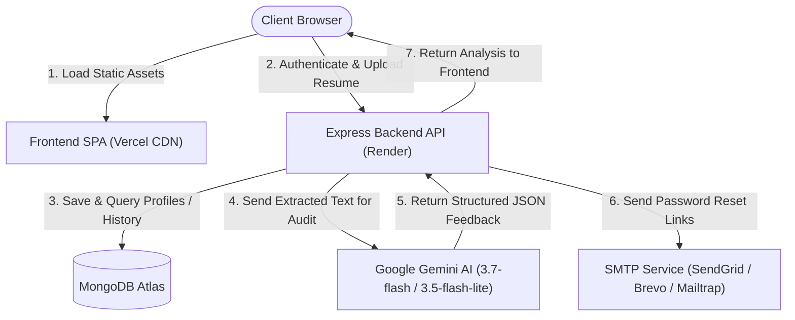

# ResumeIQ

> AI-Powered Resume Analyzer & Job Fit Evaluation Engine

[](https://opensource.org/licenses/ISC)
[](https://react.dev/)
[](https://nodejs.org/)
[](https://www.mongodb.com/)
[](https://ai.google.dev/)
[](https://resumeiq-jade.vercel.app)
[](https://resumeiq-api-0kns.onrender.com)

---

## 🌐 Live Demo

- 🖥️ **Live Web Application:** [https://resumeiq-jade.vercel.app](https://resumeiq-jade.vercel.app)
- 🔌 **API Health Endpoint:** [https://resumeiq-api-0kns.onrender.com/api/health](https://resumeiq-api-0kns.onrender.com/api/health)

---

## 📌 Description

**ResumeIQ** is a production-ready, full-stack career platform that analyzes candidate resumes against target job descriptions and industry benchmarks. Leveraging Google's high-speed Gemini models, ResumeIQ parses candidate PDF documents, computes ATS compatibility scores, detects critical keyword omissions, and delivers actionable, bullet-by-bullet enhancement suggestions.

---

## ✨ Key Features

- **📄 Robust PDF Parsing & Ephemeral Storage:** Upload PDF resumes up to 5MB. Text is parsed into memory with `pdf-parse`, and temporary uploads are immediately unlinked from disk to ensure data privacy.
- **🤖 Multi-Model AI Resilience:** Analyzes resumes with `gemini-3.7-flash` and includes seamless fallback to `gemini-3.5-flash-lite` on quota spikes or rate limits.
- **🎯 Job Description Alignment & ATS Audit:** Compares resumes directly with recruiter job requirements, highlighting matched qualifications and surfacing missing skills.
- **📊 Interactive Candidate Dashboard:** Track previous audits, review historical scores, and revisit past reports.
- **🌗 Dark / Light / System Mode:** Fully responsive UI with sleek dark/light theme switching, custom terminal-inspired audit animations, and accessible contrast.
- **⚡ Free-Tier Spin-Down Handling:** Features a silent warm-up ping on load and a non-blocking notification on `/upload` when cloud instances wake from inactivity.
- **🔐 Secure Authentication:** JWT authentication, bcrypt password hashing, rate limiting, and password reset workflows via standard SMTP / Mailtrap.
- **🛡️ Production Hardening:** Reverse proxy trust configuration, strict CORS allowlisting, and automated startup config auditing.

---

## 🛠️ Tech Stack

### Frontend
- **Core:** React 19, Vite
- **Styling:** Tailwind CSS, PostCSS
- **State & Routing:** React Router v7, Context API (`AuthContext`, `ThemeContext`, `WarmupContext`)
- **Visuals & Charts:** Recharts, Lucide React
- **HTTP Client:** Axios (with dynamic baseURL normalization and 401 interceptor)
- **Feedback:** React Hot Toast

### Backend
- **Runtime:** Node.js (v18+), Express 5
- **Database:** MongoDB Atlas via Mongoose ODM
- **Authentication:** JSON Web Tokens (JWT), Bcrypt.js
- **File Ingestion:** Multer, pdf-parse
- **AI SDK:** Google Generative AI (`@google/generative-ai`)
- **Mail:** Nodemailer (production SMTP with Mailtrap dev fallback)
- **Security:** Helmet-style headers, CORS allowlist, Express Rate Limit, Proxy Trust

---

## 🏗️ Architecture Overview



---

## ⚙️ Environment Variables

### Backend (`server/.env`)
| Variable | Description | Required | Default |
| :--- | :--- | :--- | :--- |
| `PORT` | Express server port | Optional | `5000` |
| `NODE_ENV` | Environment mode (`production` / `development`) | Recommended | `development` |
| `MONGO_URI` | MongoDB Atlas connection string | **Yes** | — |
| `JWT_SECRET` | Secret key used to sign JSON Web Tokens | **Yes** | — |
| `GEMINI_API_KEY` | Google AI Studio Gemini API Key | **Yes** | — |
| `GEMINI_MODEL` | Primary Gemini model | Optional | `gemini-3.7-flash` |
| `GEMINI_FALLBACK_MODEL` | Backup model for auto-failover | Optional | `gemini-3.5-flash-lite` |
| `GEMINI_TIMEOUT_MS` | Per-attempt timeout in milliseconds | Optional | `45000` |
| `GEMINI_TOTAL_TIMEOUT_MS` | Total deadline for all attempts | Optional | `55000` |
| `CLIENT_URL` | Allowed frontend origins (comma-separated, no trailing slash) | Recommended | `http://localhost:5173` |
| `SMTP_HOST` | Outgoing SMTP server hostname | For Emails | — |
| `SMTP_PORT` | SMTP port (`587` or `465`) | For Emails | `587` |
| `SMTP_USER` | SMTP username or API user | For Emails | — |
| `SMTP_PASS` | SMTP password or API key | For Emails | — |
| `SMTP_SECURE` | Set to `true` for SSL (port 465), or `false` for TLS | Optional | `false` |
| `FROM_NAME` | Display name for outgoing emails | Optional | `ResumeIQ` |
| `FROM_EMAIL` | Sender email address for password resets | Optional | `noreply@resumeiq.com` |

### Frontend (`client/.env`)
| Variable | Description | Required | Example |
| :--- | :--- | :--- | :--- |
| `VITE_API_URL` | Backend API base URL ending in `/api` | **Yes** | `https://resumeiq-api.onrender.com/api` |

---

## 🚀 Local Development Setup

### 1. Prerequisites
- **Node.js** (v18.x or higher)
- **npm** (v9.x or higher)
- **MongoDB** (local community server or free MongoDB Atlas cluster)
- **Google Gemini API Key** from [Google AI Studio](https://aistudio.google.com/)

### 2. Clone the Repository
```bash
git clone https://github.com/Rajksri02/resumeiq.git
cd resumeiq
```

### 3. Install Dependencies
```bash
# Root dependencies
npm install

# Backend dependencies
cd server && npm install

# Frontend dependencies
cd ../client && npm install
```

### 4. Configure Environment Variables
```bash
# Server configuration
cp server/.env.example server/.env

# Client configuration
cp client/.env.example client/.env
```
Open `server/.env` and provide your `MONGO_URI`, `JWT_SECRET`, and `GEMINI_API_KEY`.

### 5. Start Development Servers
From the repository root:
```bash
npm run dev
```
- Frontend application runs at: `http://localhost:5173`
- Backend server runs at: `http://localhost:5001` (or your configured `PORT`)
- API Health status available at: `http://localhost:5001/api/health`

---

## 📦 Production Deployment

For full deployment documentation, see the [Deployment Guide (DEPLOY.md)](./DEPLOY.md).

### Quick Deployment Summary:
- **Backend (Render):** Uses the included [`render.yaml`](./render.yaml) blueprint specification for zero-config provisioning. Set `rootDir: server`, add secret environment variables in the Render dashboard, and deploy.
- **Frontend (Vercel):** Connect the GitHub repository, set Root Directory to `client`, framework to `Vite`, and provide `VITE_API_URL=https://<your-render-url>/api`.
- **CORS Rule:** Always ensure `CLIENT_URL` on Render matches your live Vercel URL **exactly**, with **no trailing slash** (e.g., `https://resumeiq-jade.vercel.app`).

---

## 📄 License

This project is licensed under the [ISC License](LICENSE).
