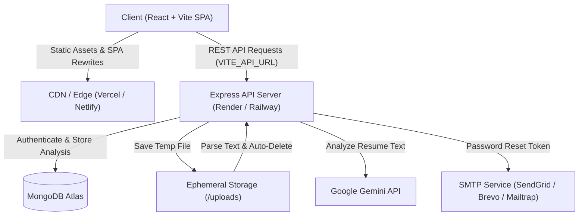

# ResumeIQ

> AI-Powered Resume Analyzer & Job Fit Evaluation Engine

[](https://opensource.org/licenses/ISC)
[](https://react.dev/)
[](https://nodejs.org/)
[](https://www.mongodb.com/)
[](https://ai.google.dev/)

---

## 🌐 Live Demo

🔗 **Demo Link:** `[Coming Soon - Deploy Pending]` *(e.g., https://resumeiq.vercel.app)*

---

## 📌 Description

**ResumeIQ** is an end-to-end intelligent career assistant that parses resumes, analyzes candidate qualifications against specific job descriptions or industry benchmarks, and delivers actionable, ATS-focused feedback. Using Google's Gemini models, ResumeIQ generates match scores, detects critical keyword gaps, highlights strengths, and suggests bullet-point improvements to help job seekers land more interviews.

---

## ✨ Features

- **📄 Intelligent PDF Parsing & Cleanup:** Upload PDF resumes up to 5MB. Resume text is extracted in memory, and temporary disk files are immediately and securely deleted upon processing.
- **🤖 Deep AI Resume Analysis:** Evaluates ATS compatibility, structural clarity, skill alignments, and quantifiable impact.
- **🎯 Job Description Match Scoring:** Compares resumes directly with targeted job descriptions, surfacing missing technical and soft skills.
- **📊 Interactive Dashboard:** Track previous analyses, review score trends, and view detailed audit breakdowns over time.
- **🔐 Secure Authentication:** Full JWT authentication, bcrypt password hashing, and tokenized password reset links sent via email.
- **🛡️ Production-Grade Hardening:** Reverse proxy trust configuration, strict CORS allowlisting, rate-limiting on sensitive endpoints (file uploads, password resets), and startup fail-fast validation.

---

## 🛠️ Tech Stack

### Frontend
- **Framework:** React 19, Vite
- **Styling:** Tailwind CSS, PostCSS
- **State & Routing:** React Router v7, Context API
- **Charts & Icons:** Recharts, Lucide React
- **HTTP Client:** Axios (with centralized baseURL and 401 interceptor)
- **Notifications:** React Hot Toast

### Backend
- **Runtime:** Node.js, Express 5
- **Database:** MongoDB (Mongoose ODM)
- **Authentication:** JSON Web Tokens (JWT), Bcrypt.js
- **File Processing:** Multer, pdf-parse
- **AI Integration:** Google Generative AI SDK (`@google/generative-ai`)
- **Email:** Nodemailer (standard SMTP & Mailtrap support)
- **Security & Reliability:** CORS allowlist, Express Rate Limit, Proxy Trust

---

## 🏗️ Architecture Overview



---

## ⚙️ Environment Variables (Names Only)

### Backend (`server/.env`)
| Variable | Description | Required |
| :--- | :--- | :--- |
| `PORT` | Port the Express server listens on (default: `5000`) | Optional |
| `NODE_ENV` | Environment mode (`production` or `development`) | Recommended |
| `MONGO_URI` | MongoDB connection string | **Yes** |
| `JWT_SECRET` | Secret key used to sign and verify JSON Web Tokens | **Yes** |
| `GEMINI_API_KEY` | Google AI Studio Gemini API Key | **Yes** |
| `CLIENT_URL` | Allowed frontend origin(s), comma-separated | Recommended |
| `SMTP_HOST` | Outgoing SMTP server hostname | For Emails |
| `SMTP_PORT` | SMTP port (`587` or `465`) | For Emails |
| `SMTP_USER` | SMTP username or API user | For Emails |
| `SMTP_PASS` | SMTP password or API key | For Emails |
| `SMTP_SECURE` | Set to `true` for SSL (port 465), or `false` for TLS | Optional |
| `FROM_NAME` | Display name for outgoing emails | Optional |
| `FROM_EMAIL` | Sender email address for password resets | Optional |
| `MAILTRAP_HOST` | Mailtrap host (development alternative) | Optional |
| `MAILTRAP_PORT` | Mailtrap port (development alternative) | Optional |
| `MAILTRAP_USER` | Mailtrap username (development alternative) | Optional |
| `MAILTRAP_PASS` | Mailtrap password (development alternative) | Optional |

### Frontend (`client/.env`)
| Variable | Description | Required |
| :--- | :--- | :--- |
| `VITE_API_URL` | Base URL of the deployed backend API (e.g. `https://resumeiq-api.onrender.com/api`) | **Yes** |

---

## 🚀 Local Setup

### 1. Prerequisites
- Node.js (v18.x or higher)
- npm (v9.x or higher)
- MongoDB instance (local or MongoDB Atlas connection string)
- Google Gemini API key from [Google AI Studio](https://aistudio.google.com/)

### 2. Clone the Repository
```bash
git clone https://github.com/Rajksri02/resumeiq.git
cd resumeiq
```

### 3. Install Dependencies
```bash
# Install root orchestration tools
npm install

# Install backend dependencies
cd server && npm install

# Install frontend dependencies
cd ../client && npm install
```

### 4. Configure Environment Variables
Copy sample configs to create your local `.env` files:

```bash
# Server configuration
cp server/.env.example server/.env

# Client configuration
cp client/.env.example client/.env
```

Open `server/.env` and supply your `MONGO_URI`, `JWT_SECRET`, and `GEMINI_API_KEY`.

### 5. Run the Application Locally
From the project root:
```bash
npm run dev
```
- Client runs at: `http://localhost:5173`
- Server API runs at: `http://localhost:5001` (or your configured `PORT`)
- Health check available at: `http://localhost:5001/api/health`

---

## 📦 Deployment Overview

### Backend (Render or Railway)
- **Root Directory:** `server`
- **Build Command:** `npm install`
- **Start Command:** `npm start`
- **Environment Variables:** Set `MONGO_URI`, `JWT_SECRET`, `GEMINI_API_KEY`, `CLIENT_URL`, `NODE_ENV=production`, and SMTP credentials.

### Frontend (Vercel or Netlify)
- **Root Directory:** `client`
- **Build Command:** `npm run build`
- **Output Directory:** `dist`
- **Environment Variables:** Set `VITE_API_URL` pointing to your backend API URL (e.g. `https://your-backend.onrender.com/api`).
- **SPA Routing:** Pre-configured with `client/vercel.json` and `client/public/_redirects`.
